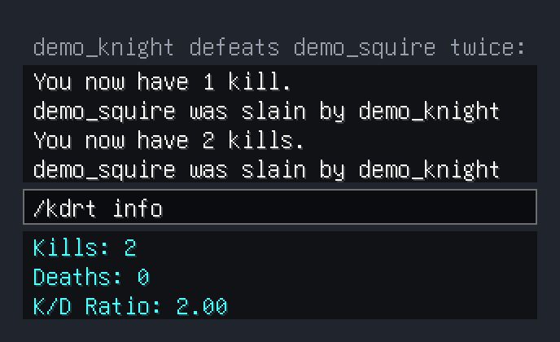

# KDR Tracker

*Real in-game output from KDR Tracker 0.3.1 on a local throwaway Paper 1.21.11 test server: the commands were typed by a scripted bot client, and the chat it received is drawn as Minecraft-style chat (typed commands appear in the input bars; grey lines say what happened between commands).*

## Description
KDR Tracker keeps count of every player's kills and deaths and shows their kill/death ratio. Players run `/kdrt info` to see their kills, deaths and K/D ratio, and each new kill or death is announced to them in chat (`You now have 3 kills.`). Every death counts, whatever the cause, and a kill counts when the victim was killed by a player. There is nothing to set up: records are created when players join and kept in `plugins/KDRTracker/playerRecords.json`, saved every 5 minutes and when the server stops.

See the [User Guide](USER_GUIDE.md), [COMMANDS.md](COMMANDS.md) and [CONFIG.md](CONFIG.md).

## Supported Minecraft Versions
This plugin is supported on the Minecraft versions listed in [`minecraft-versions.json`](minecraft-versions.json): currently **1.19.4**, **1.21.11**, **26.2** and **26.3** (Spigot and its forks). Every stable release is booted on a real server of each of these versions before it is published, and every build checks that the plugin only uses Bukkit API that exists on all of them. Other versions from 1.19.4 onwards are expected to work but are not tested. To support another version, add it to the file: both checks pick it up.

## Usage reporting

Usage reporting is on by default: when the plugin is enabled, and each time one of its commands is used, it sends its name, version and the base command name (`kdrt` or `kdrtracker`) to the author's [trace](https://trace.danielstephenson.dev) server so it is known which plugins are actually in use. Nothing about players, worlds or IPs is sent, and nothing typed after the base command, so `/kdrt info` reports `kdrt`. The plugin says on the console at every start whether reporting is on. Each event also carries a random server ID (the `server-id` line in `plugins/trace/config.yml`) so
servers can be counted rather than events. It identifies no person, account or IP address; delete
the line to get a new one.

To turn it off:

- for this plugin: set `usage-reporting.enabled` to `false` in `plugins/KDRTracker/config.yml`;
- for every plugin on the server that reports to trace: set `enabled` to `false` in `plugins/trace/config.yml` (created on first start);
- for the whole server process: set the environment variable `TRACE_USAGE_REPORTING=off` or `DO_NOT_TRACK=1`.

Details: https://danielstephenson.dev/usage-reporting

## License
KDR Tracker is open source under the [MIT License](LICENSE).
